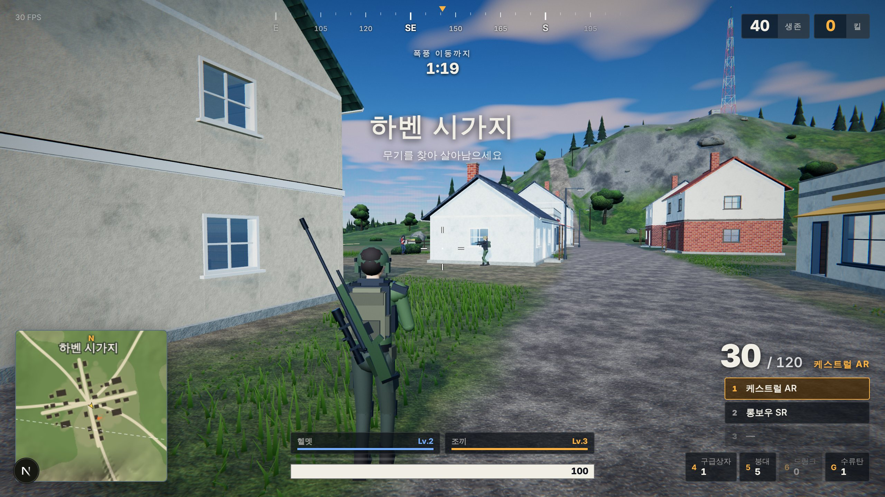
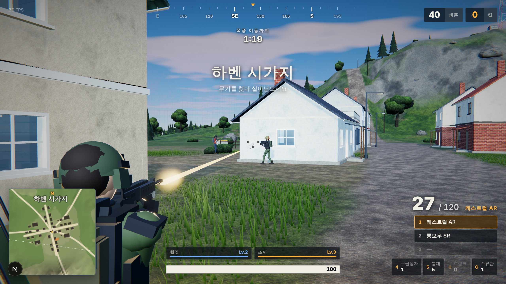
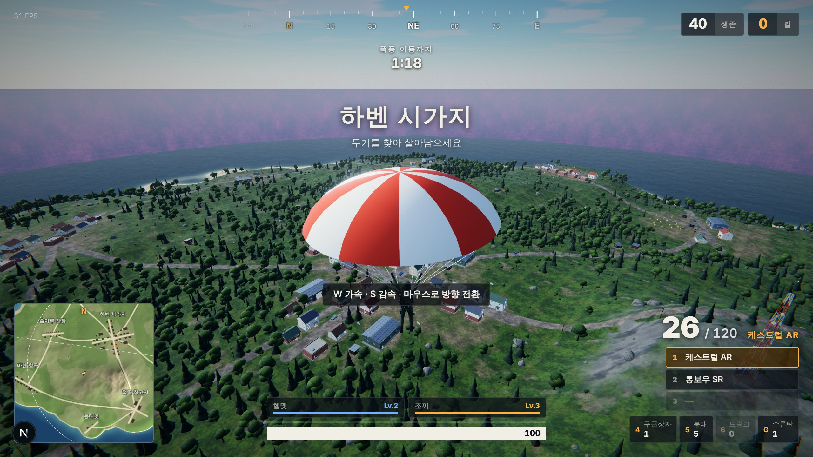

# FIGHTGROUNDS

브라우저에서 바로 실행되는 **3D 배틀로얄** 게임입니다. 40명(플레이어 + AI)이 수송기에서 강하해
무기를 줍고, 좁혀 오는 폭풍을 피해 이동하며 마지막 한 명이 남을 때까지 싸웁니다.
혼자 하거나, 방을 만들어 **최대 4명이 함께** 플레이할 수 있습니다(빈 자리는 AI).

Next.js(App Router) + three.js로 만들었고, **모델·텍스처·사운드를 포함한 모든 에셋을 코드로 생성**하기
때문에 외부 에셋 파일이 하나도 없습니다.



| 교전 | 강하 |
| --- | --- |
|  |  |

## 배틀그라운드와 다른 점

| | FIGHTGROUNDS |
| --- | --- |
| 매치 | 40명 · 10분 남짓, 폭풍이 조여 오는 섬. 설치 없이 브라우저에서 바로 시작 |
| 움직임 | 달리다 앉으면 **슬라이딩**, 허리 높이 장애물 앞에서 점프하면 **넘기**(볼트). 느리고 사실적인 이동 대신 빠르고 유연한 이동 |
| 현상금 사냥 | 새 안전 구역이 정해질 때마다 가장 많이 처치한 생존자가 **현상금 표적**이 되어 5초마다 위치가 드러남. 처치하면 Lv.3 방어구·회복템 보상 상자 |
| 초반 재강하 | 두 번째 폭풍이 닫히기 전에 쓰러지면 **한 번 더** 안전 구역 상공에서 권총을 들고 강하 |
| AI와 함께 | 빈 자리와 나간 사람을 AI가 채우고, 원하면 **오토 플레이**로 AI에게 맡길 수도 있음 |
| 같이 하기 | 방 코드·초대 링크로 최대 4명, 별도 서버 없이 Supabase Realtime |

## 실행

```bash
npm install
npm run dev      # http://localhost:3000
npm run build    # 프로덕션 빌드
```

WebGL2를 지원하는 브라우저가 필요합니다. PC는 키보드 + 마우스, 모바일은 가로 화면 터치 조작(이동 스틱 · 드래그 시점 · 액션 버튼)을 지원합니다. `?quality=low|medium|high|ultra`
쿼리나 로비의 **설정** 탭에서 그래픽 품질을 바꿀 수 있습니다.

### 온라인 랭킹 (선택)

`.env.example`을 `.env.local`로 복사하고 Supabase 프로젝트 값을 채우면 매치 결과가
`fightgrounds_matches` 테이블에 기록되고 로비·결과 화면에 랭킹이 표시됩니다.
환경 변수가 없으면 같은 화면이 브라우저 localStorage 기록으로 동작합니다.

```
NEXT_PUBLIC_SUPABASE_URL=...
NEXT_PUBLIC_SUPABASE_PUBLISHABLE_KEY=...
```

테이블은 RLS가 켜져 있으며 누구나 읽기 / 정합성 검사를 통과한 결과만 쓰기가 허용됩니다.

### 같이 하기 (멀티플레이)

같은 Supabase 설정으로 **Supabase Realtime** 채널을 사용합니다. 별도 게임 서버는 없습니다.

- 로비에서 **친구와 같이 하기 → 방 만들기**를 누르면 4자리 방 코드와 초대 링크(`/?room=CODE`)가 생깁니다.
  친구는 링크를 열거나 코드를 입력하거나, **열린 방** 목록에서 바로 참가합니다.
- 방장이 시작하면 모두 같은 수송기에 탑승하고, 남은 자리는 AI가 채웁니다.
- 방장의 브라우저가 AI·폭풍·보급품을 진행하고, 각자 자기 캐릭터를 조종합니다. 명중은 쏜 사람이 판정하고 맞은 사람 쪽에서 적용합니다.
- 경기 중 누가 나가면 그 캐릭터는 AI가 이어서 조종하고, 방장이 나가면 다음 사람이 방장 역할을 넘겨받습니다.
- 함께 하는 경기는 일시 정지 메뉴를 열어도 멈추지 않습니다. 방장 탭이 백그라운드로 가도 시뮬레이션은 계속됩니다.
- Supabase 무료 플랜의 Realtime 메시지 한도(초당 100건)에 맞춰 인원에 따라 전송 빈도를 조절합니다(2명 초당 12회 ~ 4명 약 4.5회).

## 조작

| 키 | 동작 |
| --- | --- |
| `W A S D` / 마우스 | 이동 / 시점 |
| 좌클릭 / 우클릭 | 사격(맨손은 주먹) / 정조준·스코프 |
| `Shift` / `Space` / `C` | 달리기 / 점프·장애물 넘기 / 앉기 (달리면서 누르면 슬라이딩) |
| `R` / `1 2 3` / 휠 | 재장전 / 무기 교체 |
| `F` | 강하 · 낙하산 펼치기 · 아이템 줍기 |
| `4 5 6` / `H` | 구급상자 · 붕대 · 에너지 드링크 / 자동 회복 |
| `G` | 수류탄 |
| `Tab` / `M` / `Esc` | 인벤토리 / 전체 지도 / 일시 정지 |
| `Q` / `E` · `Alt` | 기울이기 · 자유 시점 |
| `B` · `=` · 휠 클릭 | 연사/단발 전환 · 자동 달리기 · 핑 |
| `P` | 오토 플레이 (AI가 대신 플레이) |

탄약·회복 아이템·더 좋은 방어구·빈 슬롯에 들어갈 무기는 지나가기만 해도 자동으로 줍습니다.

## 게임 구성

- **섬**: 노이즈 기반 지형(1.28km), 10개 거점(시가지·항구·농장·초소·등대 등), 도로, 부두, 송신탑
- **건물**: 문·창문이 뚫린 벽, 계단이 있는 2층집, 창고, 벙커, 상점 — 모두 들어갈 수 있고 가구가 배치됨
- **캐릭터**: 18본 스켈레톤의 스킨드 메시, 2본 IK 기반 절차적 애니메이션(보행·조준·재장전·낙하·수영·사망)
- **무기 7종**: 권총, SMG, 돌격소총 2종, 산탄총, DMR, 저격소총 + 수류탄, 헬멧/조끼 Lv.1–3, 회복 아이템
- **v1.6**: 슬라이딩·장애물 넘기, 현상금 사냥, 초반 재강하 1회, 경사면에 맞춰 디디는 발, 평소에는 총을 낮춰 드는 자세
- **v1.5**: 발이 미끄러지지 않는 보행(속도에 맞춘 보폭·박자, 걷기/달리기 전환, 뒤꿈치→발끝 구름, 골반·어깨 회전, 가속·회전 기울기, 착지 충격)
- **v1.4**: 최대 4명 멀티플레이(방 코드·초대 링크·열린 방 목록, AI가 빈 자리와 이탈자를 채움), 로딩 중 셰이더 미리 컴파일로 경기 초반 끊김 제거
- **v1.3**: 모바일 아날로그 스틱 · 조준 보조 · 시점 가속 · 진동, 필요한 버튼만 보이는 간결한 화면
- **v1.2**: 오토 플레이, 자동 사격, 자동 달리기, 연사/단발 전환, 기울이기, 자유 시점, 핑, 소리 방향 표시
- **v1.1**: AI 난이도 선택(쉬움/보통/어려움), 자기장 단계마다 보급품 공중 투하, 스코프 4종(레드닷·2배·4배·8배), 피해량 숫자 표시
- **AI**: 시야각·가시선·소음 기반 인지, 건물 출입(문·계단) 경로, 루팅 우선순위, 폭풍 회피, 거리별 무기 선택,
  스킬에 따른 조준 오차·반응 속도·점사, 수류탄, 회복·후퇴 판단
- **그래픽**: PBR 재질, 대기 산란 하늘과 구름, IBL, 그림자, 바다 셰이더, GPU 인스턴스 잔디,
  식생 LOD, HDR + 블룸 + 필름 톤매핑 후처리
- **사운드**: Web Audio API로 합성(총성, 탄착, 발소리, 폭발, 바람, 수송기) — 거리 감쇠·지연·스테레오 패닝

## 업데이트

업데이트 기획과 다음 후보는 [docs/UPDATE_PLAN.md](docs/UPDATE_PLAN.md)에 정리되어 있습니다.

## 코드 구조

```
src/app            Next.js 엔트리(layout, page, 전역 CSS)
src/components     React UI — 로비, HUD, 미니맵/나침반 캔버스, 인벤토리, 결과 화면, 랭킹
src/lib/supabase   랭킹 저장소(Supabase + localStorage 폴백), Realtime 클라이언트
src/game
  Game.ts          메인 루프, 매치 흐름, HUD 동기화
  Input.ts store.ts config.ts
  core/            수학·노이즈, 절차적 지오메트리 빌더, 텍스처 합성
  world/           지형, 하늘·바다, 식생, 건물·소품, 충돌/레이캐스트, 폭풍
  entities/        캐릭터 리그·모델, 플레이어 조작/카메라, 봇 AI, 수송기
  items/           무기·아이템 정의, 루팅
  combat/          히트스캔 전투·수류탄, 파티클/트레이서/데칼
  net/             멀티플레이 — 방(Room: 프레즌스·시작 신호), 경기 동기화(NetSync)
  audio/           합성 사운드
  render/          후처리 파이프라인
```
